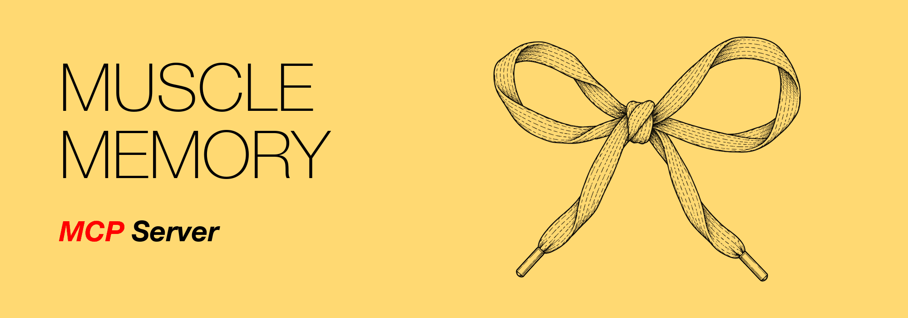

# Muscle Memory MCP Server

[](https://pypi.org/project/muscle-memory-mcp/) [](https://github.com/johannesloor/muscle-memory/actions/workflows/ci.yml) [](LICENSE)

<!-- mcp-name: io.github.johannesloor/muscle-memory -->

Your agent solves problems by writing scripts, then throws them away like they're nothing. Tomorrow it writes the same script again. Like having to figure out how to tie your shoelaces every morning. It lacks muscle memory.

The Muscle Memory MCP server gives your agent an empty library that it fills with its own tested scripts.

## Install

[](https://insiders.vscode.dev/redirect/mcp/install?name=muscle-memory&config=%7B%22command%22%3A%22uvx%22%2C%22args%22%3A%5B%22muscle-memory-mcp%22%5D%7D) [](https://insiders.vscode.dev/redirect/mcp/install?name=muscle-memory&config=%7B%22command%22%3A%22uvx%22%2C%22args%22%3A%5B%22muscle-memory-mcp%22%5D%7D&quality=insiders) [](https://cursor.com/en/install-mcp?name=muscle-memory&config=eyJjb21tYW5kIjoidXZ4IiwiYXJncyI6WyJtdXNjbGUtbWVtb3J5LW1jcCJdfQ%3D%3D) [](https://lmstudio.ai/install-mcp?name=muscle-memory&config=eyJjb21tYW5kIjoidXZ4IiwiYXJncyI6WyJtdXNjbGUtbWVtb3J5LW1jcCJdfQ%3D%3D)

**Hermes**

```sh
hermes mcp add muscle-memory --command uvx --args muscle-memory-mcp
```

**Claude Code**

```sh
claude mcp add muscle-memory -s user -- uvx muscle-memory-mcp
```

To keep the library somewhere other than the default, set `MUSCLE_MEMORY_DIR` in the server's environment.

### Codex

Add to `~/.codex/config.toml`:

```toml
[mcp_servers.muscle-memory]
command = "uvx"
args = ["muscle-memory-mcp"]
# env = { MUSCLE_MEMORY_DIR = "/absolute/path/to/library" }
```

### Cursor

Add to `~/.cursor/mcp.json`:

```json
{
  "mcpServers": {
    "muscle-memory": {
      "command": "uvx",
      "args": ["muscle-memory-mcp"]
    }
  }
}
```


## Add to your AGENTS.md

Add this standing rule to your `AGENTS.md`, `CLAUDE.md`, `SOUL.md` or equivalent agent instructions:

```text
Before writing helper code, check muscle-memory with mm_list and run a match with mm_run.
After giving the user the result, save reusable new helpers with mm_save.
Skip this for code that is itself the deliverable.
```

Tool descriptions contain the safety and testing specifics for each operation.

## First run and storage

The server exposes `mm_list`, `mm_run`, `mm_save` and `mm_setup`. If the personal library has not been set up, the tools guide the agent to ask you once where it should live and then call `mm_setup`.

The personal library defaults to `~/.muscle-memory` (`%USERPROFILE%\.muscle-memory` on Windows); `MUSCLE_MEMORY_DIR` selects another location. Scripts in the personal library are available across projects.

An optional `.muscle-memory/` project library holds scripts specific to one codebase. Project-root detection depends on the MCP client's working directory. Set `MUSCLE_MEMORY_PROJECT_DIR` to the project's absolute path in the server environment to override detection explicitly. When a script name exists in both libraries, the project copy takes precedence; listings mark the personal copy as shadowed.

For personal libraries, saves write files locally if the folder is not in git. If the library is a git repo, each saved script is committed. Setup asks whether to also push scripts to the git remote automatically; run setup again to change your answer. Project libraries are never committed or pushed automatically: you commit them with your own work. On first project setup, the agent asks whether the library should be shared through git or kept private.

## Tools

- **`mm_list(area?)`** — list available areas and script counts, or list scripts in one area.
- **`mm_run(script, args)`** — run a saved script, passing through arguments.
- **`mm_save(name, code, test, area, usage, ...)`** — save or update a script after its test passes. Supports runner, test selection, and personal/project scope options; see the tool description for the full schema and safety behavior.
- **`mm_setup(target, ...)`** — set up a personal library or optional project library. Ask the user before setup; see the tool description for modes and options.

## Advanced: languages and tests

The runner is picked by file extension: Python, bash/zsh, Node, Ruby, Perl, PHP, Swift, Go, Lua, R, PowerShell, and `.cmd`/`.bat` on Windows. Other languages need an explicit runner argv when saved. Runtimes are never installed for you; a missing one gives an error naming the command.

By default a script's test uses the same extension and runner. `test_name` and `test_runner` allow independent test selection. Tests live under `tests/test_<stem>.<ext>`; selection metadata is stored beside the script. Tests receive `MM_SCRIPT` (absolute script path) and `MM_LIBRARY` (library root). Exit status 0 passes; failed tests prevent saving. Replacing a test extension removes the prior test only after the replacement passes.

## Advanced: CLI

The same command is also a CLI:

```sh
uvx muscle-memory-mcp list [AREA]
uvx muscle-memory-mcp run SCRIPT [ARGS...]
uvx muscle-memory-mcp save NAME --code FILE --test FILE --area AREA --usage TEXT
uvx muscle-memory-mcp setup [--target personal|project] [OPTIONS]
uvx muscle-memory-mcp test [NAME]
uvx muscle-memory-mcp trust --project
```

With no arguments it starts the MCP server over stdio. `--help` lists the options.

## Security and limits

- Scripts and tests run as you, with your environment and no sandbox. Passing tests is not a security review.
- A project library runs only after you approve the project once with `uvx muscle-memory-mcp trust --project`.
- Project-library detection depends on the client's working directory; set `MUSCLE_MEMORY_PROJECT_DIR` if needed.

## License

MIT — see [LICENSE](LICENSE).
